<div align="center">




</div>

## 📌 About

A full-stack **Notes application** I built during the **10Pearls SHINE internship**. Users sign up, log in securely and create, edit and delete rich-text notes. The project followed a real team workflow: feature branches, pull requests and code reviews.

## ✨ Features

- 🔐 **JWT authentication** with bcrypt password hashing
- 📝 **Full CRUD for notes** through a REST API
- ✍️ **Rich-text editor** (React Quill)
- 🔔 **Toast notifications** and loading states
- 🧾 **Structured logging** with Pino
- 🧪 **API tests** with Mocha, Chai and Supertest

## 🛠️ Tech Stack

| Layer | Technologies |
|:--|:--|
| Frontend | React 19, React Router, Axios, React Quill, React Toastify |
| Backend | Node.js, Express 5, JWT, bcryptjs, Pino |
| Database | MySQL with Sequelize ORM |
| Testing | Mocha, Chai, Supertest |

## 🌿 Branches

| Branch | Contents |
|:--|:--|
| `feature/backend-complete` | Complete REST API (controllers, models, routes, middleware, tests) |
| `feature/frontend-complete` | Complete React client (Login, Signup, Dashboard) |
| `feature/backend-setup` | Initial Express setup |
| `dev` | Integration branch |

## 🔌 API Endpoints

| Method | Endpoint | Description |
|:--|:--|:--|
| POST | `/api/auth/signup` | Register a new user |
| POST | `/api/auth/login` | Log in and receive a JWT |
| GET | `/api/notes` | Get the user's notes |
| GET | `/api/notes/:id` | Get a single note |
| POST | `/api/notes` | Create a note |
| PUT | `/api/notes/:id` | Update a note |
| DELETE | `/api/notes/:id` | Delete a note |

## 🚀 Getting Started

```bash
git clone https://github.com/Hamnakhan123/HamnaZahid-mern-10Pshine.git
cd HamnaZahid-mern-10Pshine

# Backend
git checkout feature/backend-complete
npm install
npm run dev            # needs a .env with DB and JWT settings

# Frontend
git checkout feature/frontend-complete
npm install
npm start              # http://localhost:3000
```

---

<div align="center">

**Built by [Hamna Zahid Khan](https://github.com/Hamnakhan123)** · Software Engineer · Lecturer · Web Developer · Event Organizer

[](https://hamnakhan123.github.io/Hamna_Portfolio/)
[](mailto:hamnazahidkhan@gmail.com)
[](https://github.com/Hamnakhan123)

</div>
